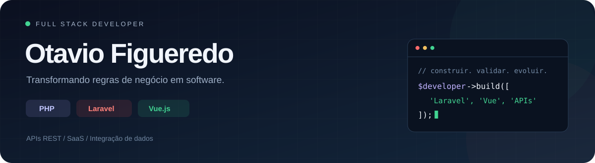
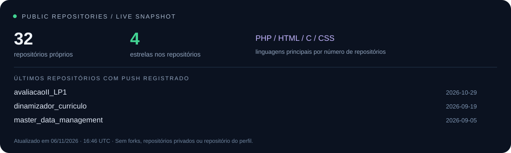

  

  

  
  
  

## Olá, sou o Otavio 👋

Desenvolvo aplicações web com **PHP, Laravel e Vue.js**, da modelagem dos dados à interface. Atuo como desenvolvedor independente desde **2023** e no **QualitySaúde, projeto da Fiotec/Fiocruz**, com APIs e integração de dados de saúde.

Estou construindo o **BarbeiroAqui**, um SaaS para a rotina de barbearias, **já utilizado por um usuário real**. Gosto de trabalhar nos detalhes que sustentam o produto: regras de negócio, permissões, consistência dos dados e integrações.

📍 São Benedito, Ceará, Brasil · 🎓 Ciência da Computação no IFCE, em andamento desde 2026.

## Minha stack

  

| Área | O que desenvolvo |
| :--- | :--- |
| **Back-end** | APIs REST, autenticação, regras de negócio, filas/jobs e processamento assíncrono com Laravel |
| **Front-end** | Interfaces com Vue.js, integração com APIs e personalização visual com Tailwind CSS |
| **Dados** | Modelagem relacional, transações, reconciliação histórica e integração de bases oficiais |
| **Qualidade e entrega** | Testes com PHPUnit, testes de integração, Git, Docker e Laravel Cloud |

Também utilizo **Python** em automações e tenho contribuições em projetos **Node.js/NestJS com TypeScript**.

## Em construção, em uso: BarbeiroAqui ✂️

**Um SaaS de gestão para barbearias, com Laravel 13, Vue 3 e Tailwind CSS.**

Da reserva pública ao registro de recebimentos, o projeto reúne a operação em uma aplicação multitenant. Está em desenvolvimento, com **um primeiro usuário em uso real**.

- **Agenda e atendimento:** profissionais, serviços, expediente, remarcações e histórico de clientes.
- **Controle financeiro:** recebimentos, formas de pagamento, comissões por profissional, receita, ticket médio e comparação entre períodos.
- **Identidade de cada barbearia:** temas, cores, logotipo, galeria e layouts da vitrine.
- **Comunicação:** confirmações e lembretes por e-mail; integração implementada com WhatsApp Cloud API, com autorização do destinatário e registro de status.
- **Arquitetura:** escopo de dados por barbearia, permissões administrativas e filas/jobs para tarefas assíncronas.

> O projeto é mais do que uma demonstração: estou desenvolvendo um produto que já faz parte da rotina de um usuário. Configuração e disponibilidade dos canais de comunicação dependem do ambiente.

**Quer conhecer o projeto? [Fale comigo](mailto:otaviofigueredo.dev@gmail.com?subject=Conhecer%20o%20BarbeiroAqui).**

## Engenharia de software e dados: QualitySaúde

No projeto da **Fiotec/Fiocruz**, desenvolvo e mantenho funcionalidades em **PHP/Laravel** para avaliações de serviços de saúde.

| Escala histórica da base em que atuo | Volume |
| :--- | ---: |
| Avaliações registradas | **8.619** |
| Notas de avaliação | **282.374** |

Minha atuação inclui validação de submissões, idempotência, transações, integração **CNES/DataSUS** e automações em **Python** para conferência e exportação de dados. Na reconciliação histórica, o foco é preservar as respostas originais e manter rastreabilidade das alterações.

Os volumes descrevem a base histórica, não avaliações criadas por mim ou usuários ativos. Código e dados de clientes não são publicados neste perfil.

## Outras entregas

| Projeto / cliente | Minha contribuição |
| :--- | :--- |
| **Estúdio Antônio Bandeira** | Plataforma de agendamentos e gestão financeira com Laravel e Vue.js, autenticação Sanctum e jobs de e-mail; publicada no Laravel Cloud. |
| **Hold Programação** | Aplicações web e integrações de pagamento; manutenção de fluxos de depósitos e saques e correções de consultas de pagamento e concorrência. |
| **Art Malha Confecções** | Sistema interno de gestão de pedidos e automação do gerenciamento de boletos. |
| **Diamond&OPP** | E-commerce regional com PHP e WordPress. |

## No GitHub, agora

  

<!-- ACTIVITY:START -->
- [etib-laravel-minicurso](https://github.com/otaviofigueredoalves/etib-laravel-minicurso) · último push registrado em 2026-11-12
- [avaliacaoII_LP1](https://github.com/otaviofigueredoalves/avaliacaoII_LP1) · último push registrado em 2026-10-29
- [dinamizador_curriculo](https://github.com/otaviofigueredoalves/dinamizador_curriculo) · último push registrado em 2026-09-19
<!-- ACTIVITY:END -->

O painel considera repositórios públicos próprios, exclui forks e este repositório de perfil. Não representa todo o trabalho profissional, que também ocorre em repositórios privados.

---

  <strong>Tem uma aplicação para construir ou evoluir?</strong> 
  <a href="mailto:otaviofigueredo.dev@gmail.com">Vamos conversar</a> · <a href="https://www.linkedin.com/in/otaviofigueredoalves">LinkedIn</a>

